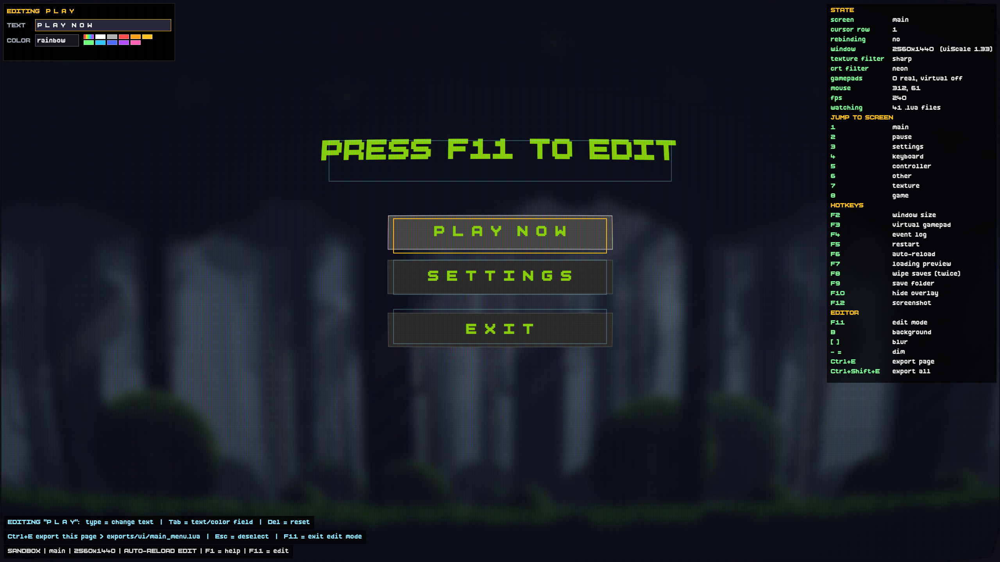
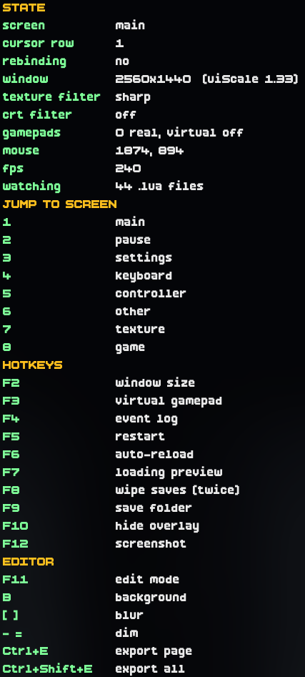
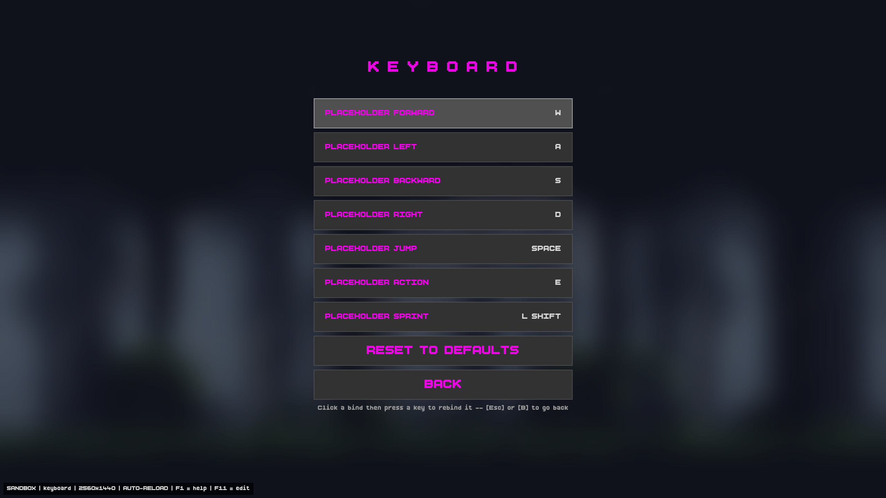
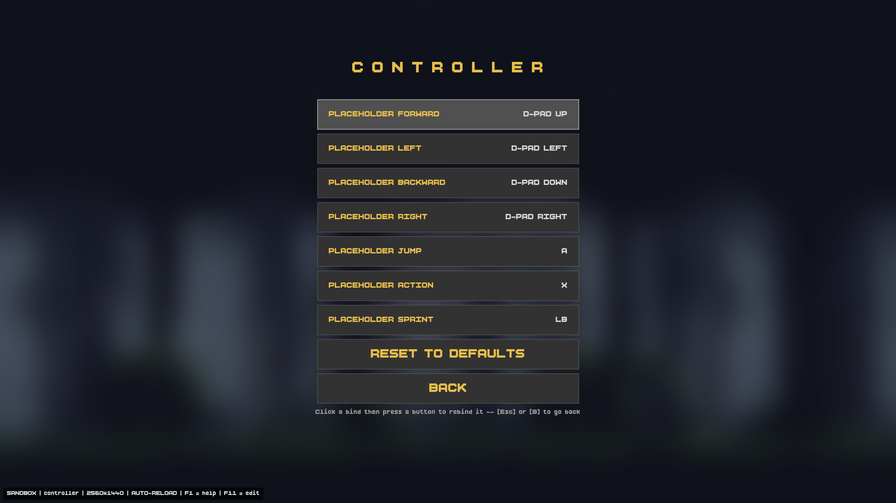
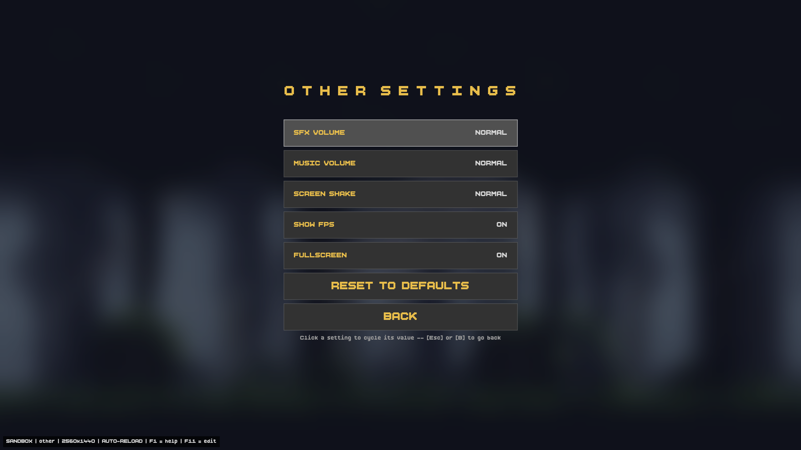
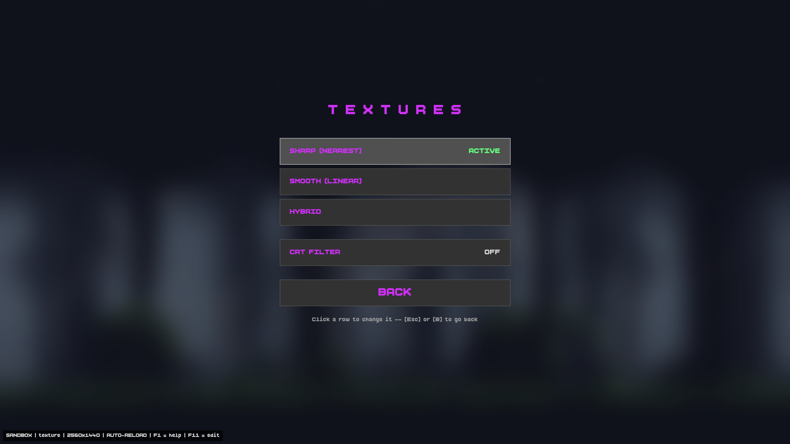
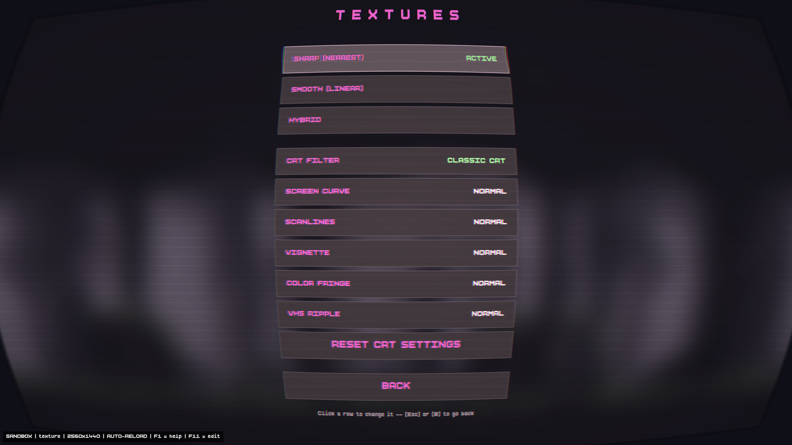

# LÖVE2D Ultimate UI Template

A drop-in, **zero-dependency** UI starter for any [LÖVE](https://love2d.org) (11.x) game: main menu, pause menu, settings with **rebindable keyboard + gamepad controls**, an "other settings" screen, a texture-filter switcher with optional CRT / LCD screen filters, a loading screen, a HUD helper, and an optional intro-video player. Pure Lua + LÖVE, no libraries.

Run it as-is (`love .`) to see a tiny demo: scroll a black-and-grey checkerboard that fills a fixed 1920x1080 (16:9) game canvas with the bound keys, press Esc to pause, and change everything from the settings screens.

## Screenshots

| Live F11 UI Editor (with F1 help panel) | Live F11 UI Editor (editing text and color) |
| :---: | :---: |
|  |  |

| Clean Exported Menu | F1 Helper Menu |
| :---: | :---: |
|  |  |

| Keyboard Rebinding | Controller Rebinding |
| :---: | :---: |
|  |  |

| Other Settings | Texture & Screen Filters (CRT off) |
| :---: | :---: |
|  |  |

| Texture & Screen Filters (CRT on) | |
| :---: | :---: |
|  | |

## Edit every menu, export in one keypress

Run `love . --sandbox`, press **F11**, click any title, button or hint on **any** screen, and type. Main menu, pause menu, HUD, Settings, Keyboard, Controller, Other, Textures and the loading screen are all editable (text and color). Then export:

| Key | Does | Works |
| --- | --- | --- |
| `Ctrl+E` (`Cmd+E` on Mac) | export the page on screen | **always**, edit mode or not |
| `Ctrl+Shift+E` | export every page | **always**, edit mode or not |

* The screen cuts to black with an animated `exporting . . .` while the files are written, then a **green toast** (`SAVED  5 files  >  exports/ultimate_ui/`) confirms it. Amber means it saved somewhere other than your project folder (the save folder, F9); red means it failed, with the reason.
* Exports land in `exports/ultimate_ui/ui/`, mirroring the real folder layout: drag that folder onto the project root, choose Replace, done. Pages you have not opened this session are included too.
* The menu background is exported as `ui/menu_background.lua`, so the picture you see in the sandbox is the picture plain `love .` shows. `return nil` in that file turns it off, and `config.menuBackground` overrides it.
* If anything goes wrong, `ultimate_ui_export_log.txt` in the save folder (F9) records exactly what was tried and why it failed.

## F1 Helper Menu: Feature Stack

Run the template with `love . --sandbox` and press **F1** (or the backtick key) at any time, on any screen, in the menus or in the game. A live helper panel opens in the top-right corner, and a status strip sits in the bottom-left corner showing the current screen, window size and active modes, with a reminder of `F1 = help | F11 = edit`.

The panel is a cheat sheet and a live readout in one:

| Section | What it gives you |
| --- | --- |
| **State** | Current screen, menu cursor row, whether a rebind is waiting, window size and UI scale, active texture filter and CRT filter, connected gamepads, mouse position, FPS, and how many `.lua` files auto-reload is watching |
| **Jump to screen** | With the panel open, press `1`-`8` to go straight to Main, Pause, Settings, Keyboard, Controller, Other, Texture, or back into the Game, with no clicking through menus |
| **Hotkeys** | `F2` window size presets, `F3` virtual gamepad, `F4` event log, `F5` restart, `F6` auto-reload, `F7` loading-screen preview, `F8` wipe saves (press twice), `F9` open the save folder, `F10` hide the overlay, `F12` clean screenshot |
| **Editor** | `F11` edit mode, `B` background, `[` `]` blur, `-` `=` dim. `Ctrl+E` exports the current page and `Ctrl+Shift+E` exports all pages, **with edit mode on or off**. Every page's titles and buttons are editable; Settings / Keyboard / Controller / Other / Textures / Loading export to `ui/page_texts.lua`, and the shared background to `ui/menu_background.lua` |

A few notes:

* It works in the play state too, so you can check the HUD and pause menu while a game is running.
* `F12` screenshots are taken before the overlay is drawn, so they come out clean.
* If you hide the overlay with `F10`, pressing `F1` brings it back. The hidden state is never restored on the next launch.
* The helper is part of the dev sandbox only. Delete `ultimate_ui/sandbox/` before you ship and none of this is in your build.

## Quick Start Guide

**1. Run it.** Install [LÖVE](https://love2d.org) 11.x, then from the project folder:

```text
love .              # the demo, exactly as players see it
love . --sandbox    # the same, plus the UI editor and dev tools
```

**2. Add it to your own game.** Everything lives in **one self-contained folder**, so there is nothing to
merge and nothing in your project root can collide with it (your own `input.lua`, `audio.lua`,
`config.lua`, `ui/` ... are safe). Copy `ultimate_ui/` into your project and:

```lua
local UI = require("ultimate_ui")      -- or require("libs.ultimate_ui") if you put it in libs/

function love.load()
    UI.configure{ title = "MY GAME", version = "v1.0.0" }   -- optional; or edit ultimate_ui/config.lua
    UI.init()                                               -- sets up every module, in the right order
end
```

Modules load lazily the first time you touch them. `main.lua` in this repo is the reference for hooking
the draw / keyboard / mouse / gamepad callbacks up to your game (delete the "YOUR GAME" block and keep the rest).
The folder can be renamed or moved anywhere: every file finds its siblings relative to its own location.

| You want | Use |
| --- | --- |
| Draw / click functions for every menu (`drawMainMenu`, `drawPauseMenu`, ...) | `UI.ui` |
| Menu flow state (main menu, pause, which screen is open) | `UI.state` |
| One-call keyboard **and** gamepad checks | `UI.input` (`isDown`, `pressedKey`, `pressedButton`) |
| Rebinding | `UI.keybinds`, `UI.controller` |
| Menu event routing (`keypressed`, `mousepressed`, `gamepadpressed`) | `UI.menu_input` |
| Volumes, `playSFX`, `playMusic` | `UI.audio` |
| Menu click + loading-screen sounds (drop `ui.ogg` / `loading.ogg` in `ultimate_ui/sounds/`) | `UI.sounds` |
| Texture filter / CRT filters | `UI.textures`, `UI.crt` |
| Loading screen / intro videos | `UI.loading`, `UI.intro` |
| Title, version, font, intro videos | `UI.config` / `UI.configure{...}` |
| Build your own data-driven screens | `UI.widgets` |
| Path of a file inside the folder | `UI.path("background/my_image.png")` |

Every module can also be required directly, e.g. `require("ultimate_ui.keybinds")`.

## Sounds

Two sounds are wired up out of the box, with examples in `ultimate_ui/sounds/`:

* **Button click:** every menu button (mouse click, Enter, gamepad A, Esc / B for "back") plays `ui.ogg`.
* **Loading screen:** `loading.ogg` plays when PLAY starts the loading screen, and **the screen lasts exactly as long as the sound**.

To use your own, drag a file named `ui` and/or `loading` (`.ogg`, `.mp3` or `.wav`) into `ultimate_ui/sounds/`. It
replaces the bundled `example_ui.ogg` / `example_loading.ogg` automatically, with no code or config. Both follow the
Settings -> Other -> SFX volume. Details, and how to use them from your own code, are in `ultimate_ui/sounds/README.md`.

## Startup checks & console output

`UI.init()` runs a quick self-check and prints a **WARNING** for anything that would otherwise just make the menus look wrong:
a missing menu background image, no `.ttf` / `.otf` in `fonts/`, no screen-filter files in `crt_filters/` (or one that
`crt_manager.lua` does not list), a missing / non-`.ogv` intro video, a sound in `sounds/` that will not decode or has an
unusable extension, a save folder it cannot write to, a LOVE version other
than 11.x, and the sandbox folder left in a packaged build. Turn it off with `startupChecks = false` in `config.lua`.

To see the output:

* **Windows:** run the game with `lovec.exe` (the console build of LOVE), or set `t.console = true` in `conf.lua`.
* **Linux / macOS:** run `love .` from a terminal.
* **Sandbox:** the same lines also show in its on-screen log (**F4**).

Your own code can use the same logger: `UI.log.warn("...")`, `UI.log.warnOnce(key, "...")`, `UI.log.log("...")`.

## Folder layout

```text
main.lua, conf.lua        demo only: the "YOUR GAME" toy and its window settings
ultimate_ui/              <- the whole library: copy this folder, nothing else
  init.lua                the single entry point  (require("ultimate_ui"))
  config.lua              title, version, font, intro videos, ...
  ui/                     the screens: main menu, pause, settings, keyboard, controller, ...
                          (page_texts.lua = edited texts, menu_background.lua = shared background: both exported here)
  fonts/  background/     drop your .ttf and your menu background images here
  sounds/                 drop ui.ogg (button click) and loading.ogg (loading screen) here
  crt_filters/            the screen-filter shaders
  sandbox/                dev tools (love . --sandbox); delete before you ship
  audio.lua  ui_sounds.lua  input.lua  keybinds.lua  controller.lua  menu_input.lua  checks.lua  debuglog.lua  ...
exports/                  where the sandbox editor writes exported pages (drag exports/ultimate_ui onto the project root)
reference_screenshots/    the images used in this README
```

## Upgrading from the old flat layout

Earlier versions put ~20 files straight in the project root. If you cloned that version:

- **Requires.** `require("ui_state")` becomes `UI.state` (or `require("ultimate_ui.ui_state")`); the same goes for
  `keybinds`, `controller`, `input`, `audio`, `fonts`, `config`, `menu_input`, `other_settings`,
  `texture_filter_manager` (`UI.textures`), `crt_manager` (`UI.crt`), `loading_screen` (`UI.loading`),
  `intro_sequence` (`UI.intro`) and `debuglog` (`UI.log`).
- **Your edits.** Anything you changed in a root file (`config.lua`, `ui/main_menu.lua`, ...) belongs in the same-named
  file inside `ultimate_ui/`.
- **Assets.** Fonts and backgrounds now live in `ultimate_ui/fonts/` and `ultimate_ui/background/`.
- **Save files** gained an `ultimate_ui_` prefix (`keybinds.txt` -> `ultimate_ui_keybinds.txt`, and so on) so they
  can't collide with your game's own files. Players' saved settings reset once; rename the old files in the save
  folder if you want to carry them over.
- **Exports.** The sandbox editor now writes to `exports/ultimate_ui/ui/...`, mirroring the real path. Export works with edit mode on or off (`Ctrl+E` / `Ctrl+Shift+E`).
