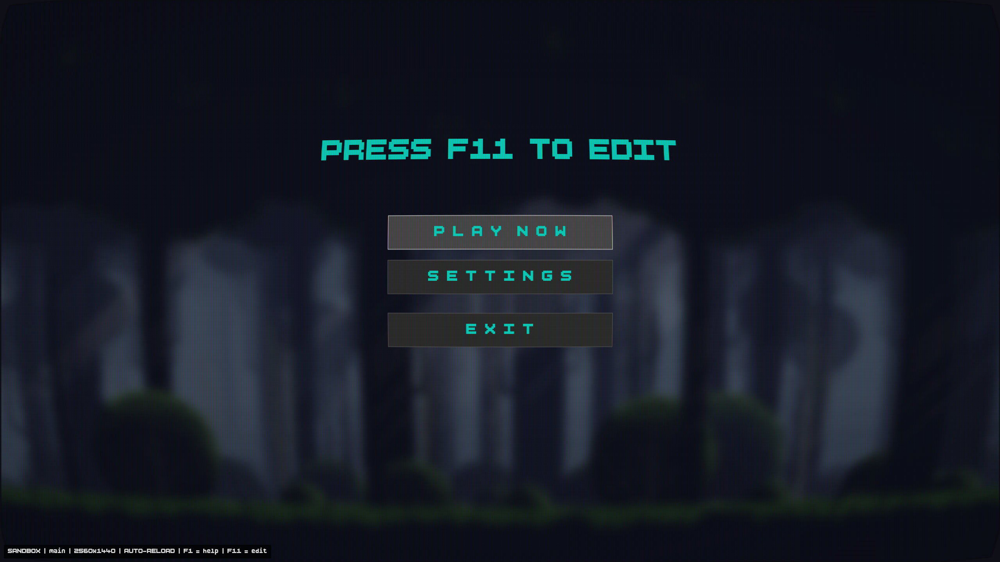

# LÖVE2D Ultimate UI Template

A drop-in, **zero-dependency** UI starter for any [LÖVE](https://love2d.org) (11.x) game: main menu, pause menu, settings with **rebindable keyboard + gamepad controls**, an "other settings" screen, a texture-filter switcher with optional CRT / LCD screen filters, a loading screen, a HUD helper, and an optional intro-video player. Pure Lua + LÖVE, no libraries.

Run it as-is (`love .`) to see a tiny demo: move a checkerboard square with the bound keys, press Esc to pause, and change everything from the settings screens.

## Screenshots

| Live F11 UI Editor | Clean Exported Menu |
| :---: | :---: |
|  |  |

## Quick Start Guide

**1. Run it.** Install [LÖVE](https://love2d.org) 11.x, then from the project folder:

```text
love .              # the demo, exactly as players see it
love . --sandbox    # the same, plus the UI editor and dev tools
```
