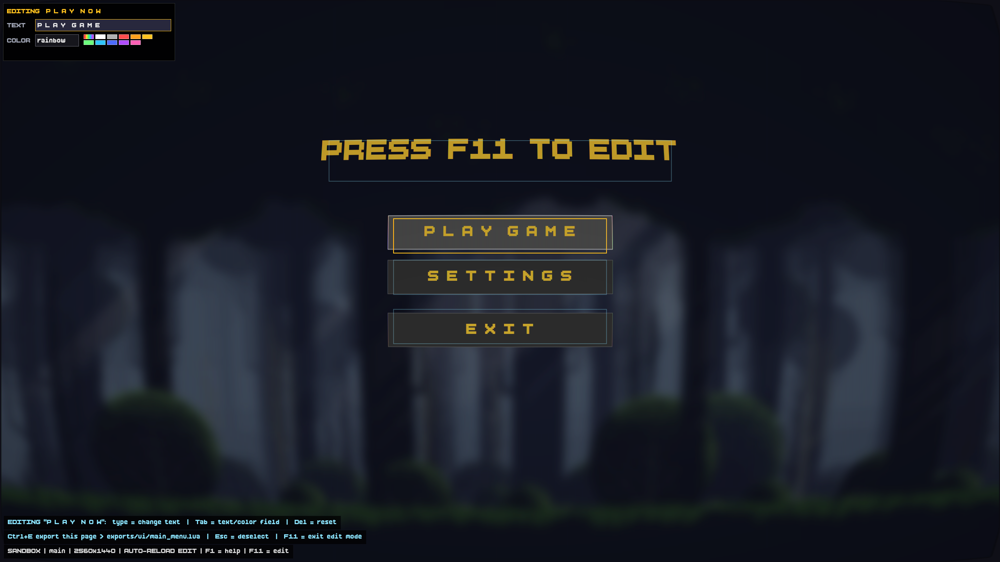
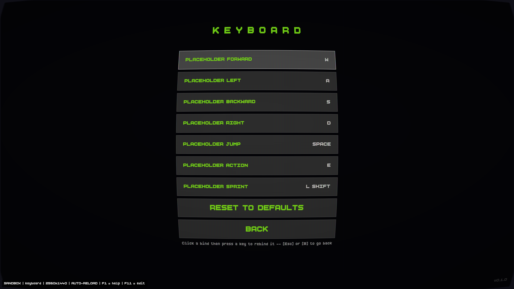
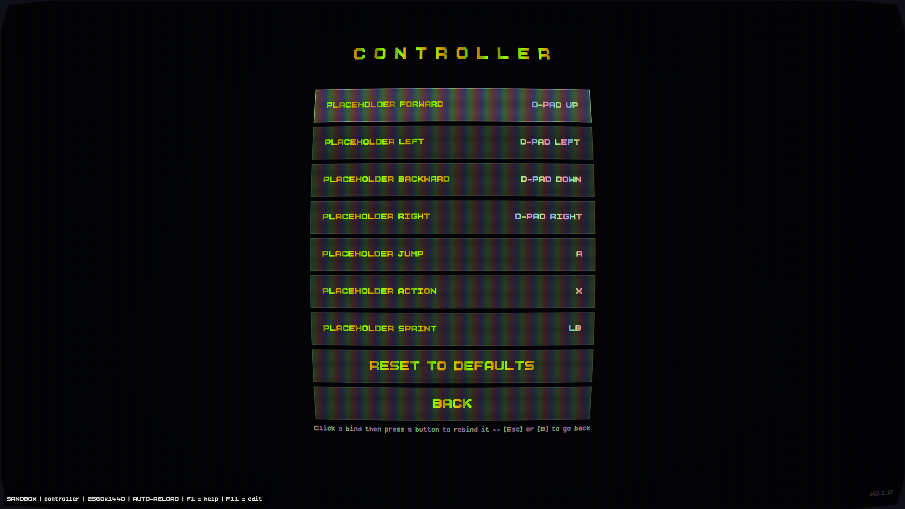
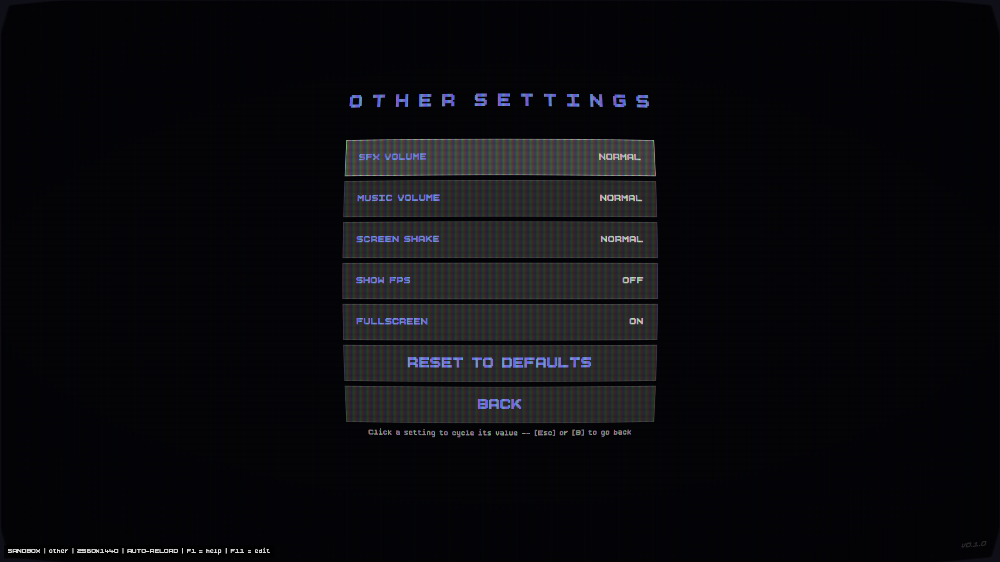
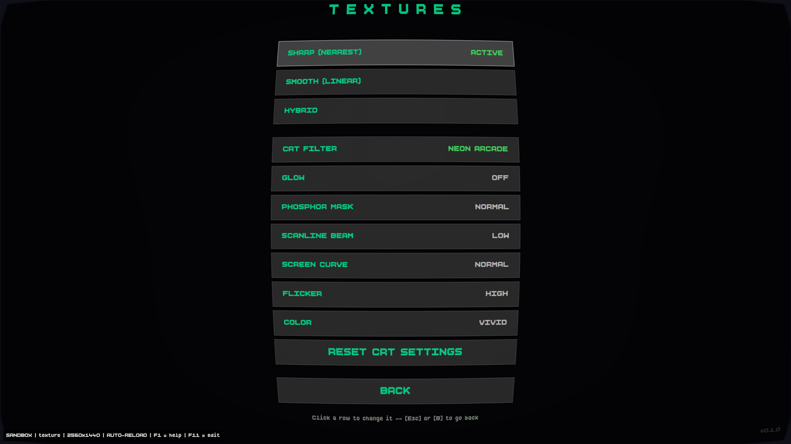

# LÖVE2D Ultimate UI Template

A drop-in, **zero-dependency** UI starter for any [LÖVE](https://love2d.org) (11.x) game: main menu, pause menu, settings with **rebindable keyboard + gamepad controls**, an "other settings" screen, a texture-filter switcher with optional CRT / LCD screen filters, a loading screen, a HUD helper, and an optional intro-video player. Pure Lua + LÖVE, no libraries.

Run it as-is (`love .`) to see a tiny demo: move a checkerboard square with the bound keys, press Esc to pause, and change everything from the settings screens.

## Screenshots

| Live F11 UI Editor | Clean Exported Menu |
| :---: | :---: |
|  |  |

| UI Editor Overview | Keybinds Settings |
| :---: | :---: |
|  |  |

| Controller Binds | Other Settings |
| :---: | :---: |
|  |  |

| Texture & Screen Filters | |
| :---: | :---: |
|  | |

## Quick Start Guide

**1. Run it.** Install [LÖVE](https://love2d.org) 11.x, then from the project folder:

```text
love .              # the demo, exactly as players see it
love . --sandbox    # the same, plus the UI editor and dev tools
```

**2. Add it to your own game.** Everything lives in **one self-contained folder**, so there is nothing to
merge and nothing in your project root can collide with it (your own `input.lua`, `audio.lua`,
`config.lua`, `ui/` ... are safe). Copy `ultimate_ui/` into your project and:

```lua
local UI = require("ultimate_ui")      -- or require("libs.ultimate_ui") if you put it in libs/

function love.load()
    UI.configure{ title = "MY GAME", version = "v1.0.0" }   -- optional; or edit ultimate_ui/config.lua
    UI.init()                                               -- sets up every module, in the right order
end
```

Modules load lazily the first time you touch them. `main.lua` in this repo is the reference for hooking
the draw / keyboard / mouse / gamepad callbacks up to your game (delete the "YOUR GAME" block and keep the rest).
The folder can be renamed or moved anywhere: every file finds its siblings relative to its own location.

| You want | Use |
| --- | --- |
| Draw / click functions for every menu (`drawMainMenu`, `drawPauseMenu`, ...) | `UI.ui` |
| Menu flow state (main menu, pause, which screen is open) | `UI.state` |
| One-call keyboard **and** gamepad checks | `UI.input` (`isDown`, `pressedKey`, `pressedButton`) |
| Rebinding | `UI.keybinds`, `UI.controller` |
| Menu event routing (`keypressed`, `mousepressed`, `gamepadpressed`) | `UI.menu_input` |
| Volumes, `playSFX`, `playMusic` | `UI.audio` |
| Texture filter / CRT filters | `UI.textures`, `UI.crt` |
| Loading screen / intro videos | `UI.loading`, `UI.intro` |
| Title, version, font, intro videos | `UI.config` / `UI.configure{...}` |
| Build your own data-driven screens | `UI.widgets` |
| Path of a file inside the folder | `UI.path("background/my_image.png")` |

Every module can also be required directly, e.g. `require("ultimate_ui.keybinds")`.

## Folder layout

```text
main.lua, conf.lua        demo only: the "YOUR GAME" toy and its window settings
ultimate_ui/              <- the whole library: copy this folder, nothing else
  init.lua                the single entry point  (require("ultimate_ui"))
  config.lua              title, version, font, intro videos, ...
  ui/                     the screens: main menu, pause, settings, keyboard, controller, ...
  fonts/  background/     drop your .ttf and your menu background images here
  crt_filters/            the screen-filter shaders
  sandbox/                dev tools (love . --sandbox); delete before you ship
  audio.lua  input.lua  keybinds.lua  controller.lua  menu_input.lua  ...
exports/                  where the sandbox editor writes exported pages
```

## Upgrading from the old flat layout

Earlier versions put ~20 files straight in the project root. If you cloned that version:

- **Requires.** `require("ui_state")` becomes `UI.state` (or `require("ultimate_ui.ui_state")`); the same goes for
  `keybinds`, `controller`, `input`, `audio`, `fonts`, `config`, `menu_input`, `other_settings`,
  `texture_filter_manager` (`UI.textures`), `crt_manager` (`UI.crt`), `loading_screen` (`UI.loading`),
  `intro_sequence` (`UI.intro`) and `debuglog` (`UI.log`).
- **Your edits.** Anything you changed in a root file (`config.lua`, `ui/main_menu.lua`, ...) belongs in the same-named
  file inside `ultimate_ui/`.
- **Assets.** Fonts and backgrounds now live in `ultimate_ui/fonts/` and `ultimate_ui/background/`.
- **Save files** gained an `ultimate_ui_` prefix (`keybinds.txt` -> `ultimate_ui_keybinds.txt`, and so on) so they
  can't collide with your game's own files. Players' saved settings reset once; rename the old files in the save
  folder if you want to carry them over.
- **Exports.** The sandbox editor now writes to `exports/ultimate_ui/ui/...`, mirroring the real path.
